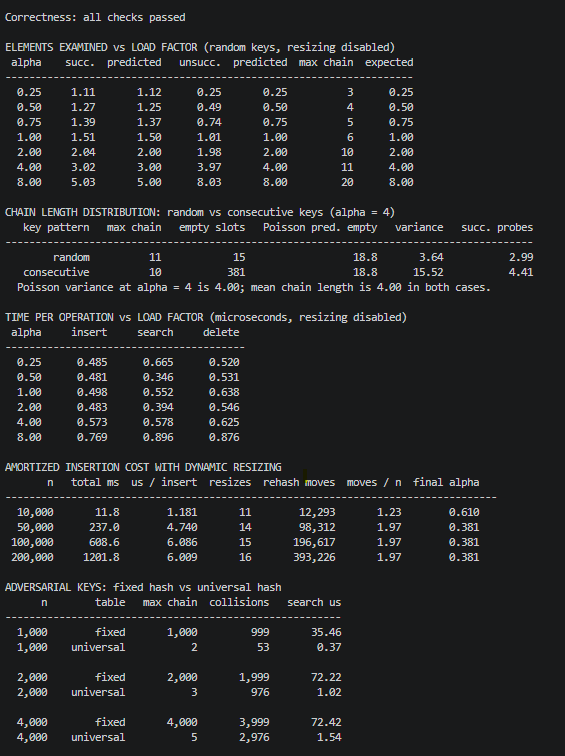

# Hashing with Chaining

This project implements a hash table with separate chaining, randomized hash parameters, and dynamic resizing. It also tests the table and measures how load factor and key patterns affect search cost.

## Files

| File | Purpose |
| --- | --- |
| `hash_table.py` | `HashTable`, the fixed-hash comparison class `BadHashTable`, correctness tests, and five experiments |
| `result_part2.png` | Screenshot of the same run |

## Run

Requires Python 3.8 or newer and only the standard library.

```bash
python hash_table.py
```

## Result



The script runs correctness tests first. If a test fails, it exits with a nonzero status. It then prints the experiment results. A full run takes about a minute on the machine used for the reported results; your timing will vary.

## Hash function and key domain

For `m` slots, the table chooses `a` and `b` and computes

```text
h(k) = ((a*k + b) mod p) mod m
p = 2^61 - 1,  a in {1, ..., p-1},  b in {0, ..., p-1}
```

A new pair `(a, b)` is chosen whenever the table resizes. This is a universal hash family **when the integer representations of distinct keys are distinct modulo `p`**: for each eligible pair, the probability of collision over the choice of `(a, b)` is at most `1/m` (Carter & Wegman, 1979).

The implementation accepts a wider range of keys. It uses integer keys directly, including negative and large integers, and converts other hashable Python keys with `hash()`. Therefore the universal guarantee does **not** cover every key it accepts. For example, `0` and `p` always have the same residue modulo `p`; two unequal objects may also have the same Python hash. The experiments show what happened for their tested keys, not a guarantee for all Python objects.

## API

```python
t = HashTable(initial_capacity=8, max_load=0.75, min_load=0.25,
              auto_resize=True, seed=None)

t.insert(key, value)       # Add a key or replace its value
t.search(key, default)     # Return the value, or default if absent
t.delete(key)              # Return the removed value; KeyError if absent

t[key] = value
value = t[key]             # KeyError if absent
del t[key]
present = key in t
count = len(t)
entries = t.items()
alpha = t.load_factor
summary = t.stats()
```

Each slot holds a Python list of `(key, value)` pairs. Insert scans that list so it can update an existing key instead of creating a duplicate. After finding a key, delete moves the last entry into its place and removes the last list element. That removal step takes `O(1)` time; finding the key still requires a chain scan.

The table doubles when its load factor rises above `0.75` and halves when it falls below `0.25`, without shrinking below the initial capacity. Using different growth and shrink limits avoids resizing after every operation near one boundary. Set `auto_resize=False` to hold the slot count fixed for an experiment.

`BadHashTable` uses the known fixed rule `h(k) = k mod m`. It is included only as a comparison in the adversarial-key experiment.

## Expected cost

Let `n` be the number of stored keys, `m` the number of slots, and `α = n/m` the load factor. With chaining, `α` is the **average number of entries per slot** and can exceed 1.

Under *simple uniform hashing*, keys map independently and uniformly to slots. Expected costs between resizes are:

| Operation | Expected time | Reason |
| --- | --- | --- |
| Unsuccessful search | `Θ(1 + α)` | It scans the whole chain. |
| Successful search | `Θ(1 + α)` | For a uniformly chosen stored key, it examines `1 + (n-1)/(2m)` entries on average. |
| Insert or update | `Θ(1 + α)` | It scans for an existing key before appending. |
| Delete by key | `Θ(1 + α)` | It finds the entry, then removes it in `O(1)`. |

The universal-family argument needs a weaker condition than simple uniform hashing. For a fixed set of keys with distinct representations modulo `p`, chosen independently of `(a, b)`, each pair collides with probability at most `1/m`. Adding these collision probabilities gives an **expected `O(1 + α)` upper bound** for a chain scan. It does not imply independent slot assignments, an exact Poisson chain distribution, or short chains for every sampled function. It also does not cover keys chosen adaptively after the current hash behavior is learned.

Resizing keeps `α` bounded, so the expected operation cost stays `O(1)` under the relevant assumptions. A resize can take `Θ(n)` time, but doubling and halving spread that work over many updates, giving expected amortized `O(1)` update cost. The worst case for one chain scan remains `O(n)`.

## Results from one run

The timings below are measurements from that run, not hardware-independent predictions.

| Experiment | Observation |
| --- | --- |
| Search probes, `m = 1,024` | At `α = 0.25`, a successful search examined 1.11 entries and an unsuccessful search 0.25. At `α = 8`, the means were 5.03 and 8.03. |
| Chain lengths, `α = 4` | Random keys were close to the Poisson approximation: variance 3.64 versus about 4.00. Consecutive keys had variance 15.52 and 381 empty slots, despite the same mean chain length of 4. A successful search examined 4.41 entries with consecutive keys against 2.99 with random keys. |
| Resizing | At `n = 200,000`, the run recorded 16 resizes and 393,226 rehash moves, or 1.97 moves per inserted key. |
| Fixed-key attack, `m = 1,024` | With 4,000 multiples of 1,024, `k mod m` put all keys in one chain. The sampled universal-family table's longest chain was 5; measured search time was 72.42 µs versus 1.54 µs. |

The consecutive-key result shows why the **mean** chain length alone does not predict successful-search cost: long chains hold more keys, so they weigh more heavily when a stored key is selected for search. Averaging over stored keys gives `(1/n) Σ n_j(n_j + 1)/2` expected probes, which is quadratic in chain length. That expression predicts 2.96 probes for the random-key distribution and 4.44 for the consecutive-key one, close to the measured 2.99 and 4.41 — a 47% penalty at the same mean. A Poisson distribution is an approximation under the simple-uniform model, not a requirement of a universal family.

For resizing, measured time per insert rose from 1.18 µs at 10,000 keys to 6.01 µs at 200,000 keys — about fivefold — even while rehash moves per key remained bounded at 1.97. These measurements do not establish the cause of the time increase; the amortized bound counts work, not exact microseconds.

In the fixed-key experiment, the universal-family table searched about **47 times faster** at `n = 4,000`. Crosby and Wallach (2003) showed that collision-forcing input of this kind is a practical denial-of-service technique against real systems, not only a theoretical concern. The result here demonstrates the effect for that key set and sampled function; it is not a worst-case or adaptive-attack guarantee. The fixed-hash bucket is a Python list scanned linearly, not a linked list.

## Correctness checks

The reported tests cover empty and missing entries, updates, deletion, falsy values, and mixed key types such as `0`, `""`, `False`, `None`, negative integers, floats, and tuples. One test compares 20,000 mixed operations with a Python `dict`. Another checks entries through repeated growth and shrinkage.

## References

Carter, J. L., & Wegman, M. N. (1979). Universal classes of hash functions. *Journal of Computer and System Sciences, 18*(2), 143–154. https://doi.org/10.1016/0022-0000(79)90044-8

Cormen, T. H., Leiserson, C. E., Rivest, R. L., & Stein, C. (2022). *Introduction to algorithms* (4th ed.). MIT Press.

Crosby, S. A., & Wallach, D. S. (2003). Denial of service via algorithmic complexity attacks. In *Proceedings of the 12th USENIX Security Symposium* (pp. 29–44). USENIX Association. https://www.usenix.org/conference/12th-usenix-security-symposium/denial-service-algorithmic-complexity-attacks
